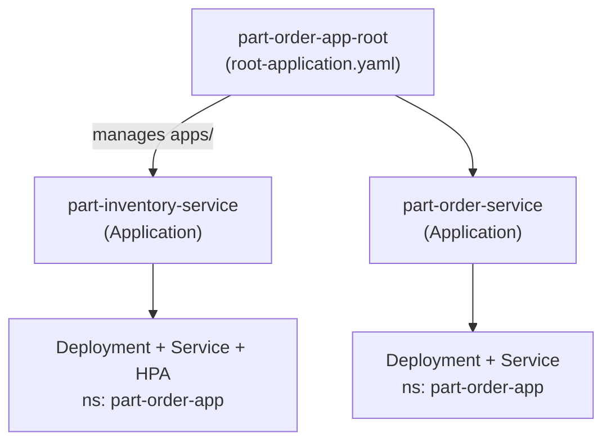

# argocd-app-of-apps

Argo CD **App of Apps**: one root `Application` whose "manifests" are other
`Application` objects. Apply the root once; Argo CD creates, syncs and
prunes everything under `apps/`.



```text
root-application.yaml                # apply by hand, once
apps/part-inventory-service.yaml     # child Application
apps/part-order-service.yaml         # child Application
```

The children deploy the part-order-app manifests that live in
[devops-learning-journey](https://github.com/ramanujds/devops-learning-journey)
(`applications-and-source-code/part-order-app-java/k8s/`) — this repo holds
only the Argo CD wiring.

## Use

Prerequisite: Argo CD installed —
[installation notes](https://github.com/ramanujds/devops-learning-journey/blob/main/git-ops-argocd/04-argocd-installation.md).

```bash
kubectl apply -f root-application.yaml -n argocd

argocd app get part-order-app-root
kubectl get applications -n argocd      # root + the two it created
kubectl get all -n part-order-app
```

Add a service: drop another `Application` YAML into `apps/`, commit,
push — the root's automated sync picks it up, no more `kubectl apply`.

## Deleting a child

Deleting a file from `apps/` makes the root prune that child
`Application`. The child currently has **no**
`resources-finalizer.argocd.argoproj.io`, so its Deployment/Service are
left running (orphaned). To have pruning clean up the workloads too, add
to each child's metadata:

```yaml
  finalizers:
    - resources-finalizer.argocd.argoproj.io
```

Concepts: [devops-learning-journey/git-ops-argocd](https://github.com/ramanujds/devops-learning-journey/tree/main/git-ops-argocd).
